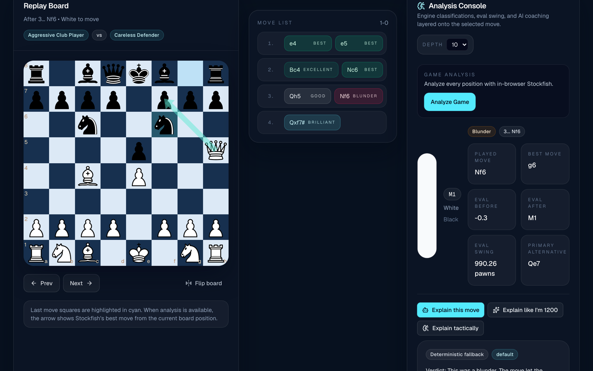

# Stockfih v1 (archived)

This branch holds the first version of Stockfih: a Next.js web app that runs
Stockfish in the browser and asks a language model to explain the moves.

It is frozen. Stockfih is being rebuilt on `main` as a desktop app that is as
much a tool for looking inside Stockfish as it is a chess tutor. Read
[`main`'s README](https://github.com/kanishkpaul/stockfih/tree/main) for that
version. Nothing new lands here; fixes go into the rebuild.



## What v1 does

Paste a PGN and Stockfih replays it on a board. **Analyze Game** runs
Stockfish 18 (WebAssembly, single thread, in a Web Worker) on every position
at depth 8 to 14 with three candidate lines, then labels each move from Best
to Blunder by how many centipawns it lost.

Pick a move and ask for an explanation in one of three styles: plain,
"like I'm 1200", or tactical. A server route sends the engine's verdict to a
model on the Hugging Face router, so the token never reaches the browser.
Without a token, a fixed template answers instead. Explanations are cached in
`localStorage`.

## Run it

Needs Node 20.9 or newer.

```bash
git switch old
npm install
npm run dev
```

Open http://localhost:3000, click **Load sample game**, then **Analyze Game**.

For model-written explanations, put this in `.env.local`:

```bash
HF_TOKEN=hf_...
HF_MODEL=mistralai/Mistral-7B-Instruct-v0.3
```

## Known problems

These were found in a review on 2026-10-13 and are why v1 was retired rather
than patched. The rebuild is designed around them.

- **Explanations leak between games.** The cache key is the move's index and
  UCI string, not the game, so two games that play the same move at the same
  ply share one explanation.
- **A failed model call is cached forever.** The route quietly substitutes the
  template, and the client stores it as if it were the real answer.
- **Loading a game mid-analysis mixes games.** The analysis loop has no
  cancellation and keeps writing results for the game it started with.
- **Mate scores distort classification.** Mate in N is scored as
  `100000 - N * 1000`, so a move that turns mate in 3 into mate in 5 is a
  "Blunder", and "allows mate" shows as about 990 pawns. Checkmated positions
  get no score at all, because Stockfish reports `score mate 0` without a
  principal variation and the parser requires one.
- **Labels ignore how winning the position is.** Fixed centipawn thresholds
  treat losing two pawns at +10 the same as at 0.
- **Engine timeouts never send `stop`**, so a late `bestmove` can resolve the
  next request.
- **The explain route accepts anything.** No size limits, no rate limit, and
  the tone is not checked against the allowed values.
- **Dependencies:** Next.js 16.2.6 has open advisories (fixed in 16.3.8 and
  later), `npm run lint` reports two errors, `zustand` and the 10 MB asm.js
  engine build are unused, and `npm install` rewrites the committed engine
  files' modes.

## Layout

```text
app/api/explain/route.ts   model call, server side
components/                board, move list, analysis panel, PGN input
lib/stockfish.ts           Web Worker UCI client
lib/classify.ts            move classification and eval formatting
lib/prompts.ts             prompts and template explanations
scripts/copy-stockfish.mjs postinstall copy of the engine build
```

## License

Stockfih's code is MIT. The Stockfish files in `public/stockfish/` are GPLv3,
from the [`stockfish`](https://www.npmjs.com/package/stockfish) npm package,
with their license in `Copying.txt`.
