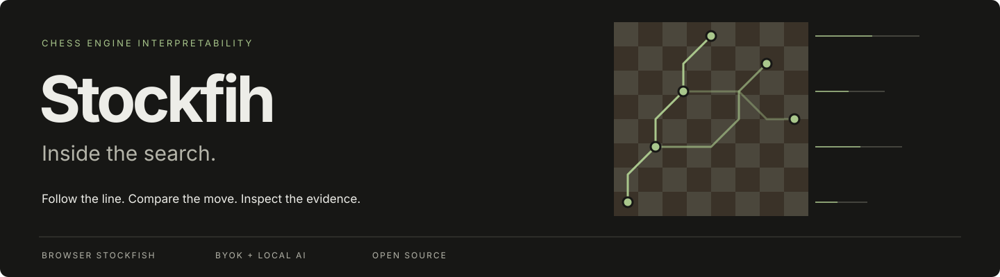

<p align="center">
  
</p>

<p align="center">
  A chess web app for inspecting what Stockfish searches.<br />
  Review games, explore alternatives, and follow the evidence behind every move.
</p>

<p align="center">
  <a href="https://github.com/kanishkpaul/stockfih/actions/workflows/check.yml"></a>
  <a href="https://github.com/kanishkpaul/stockfih/actions/workflows/attribution.yml"></a>
</p>

<p align="center">
  <a href="#run-locally">Run locally</a> ·
  <a href="docs/demo/walkthrough.webm">Watch the demo</a> ·
  <a href="docs/ARCHITECTURE.md">Architecture</a> ·
  <a href="docs/AUDIT-STATUS.md">Scope &amp; limits</a>
</p>

---

## The board is the starting point

Stockfish gives you a move and a score. Stockfih lets you inspect the position,
the continuation, how the search changed with depth, and what happens when you
force a different move. Every game move and every principal-variation ply can
be replayed from its own position.

**The engine decides. Optional AI selects checked facts. The workspace works without a model key.**

| Review a game | Explore a position |
| :--- | :--- |
| Import PGN text or a file | Load a FEN or branch from the board |
| Navigate the main line and critical moves | Play legal drag, click or keyboard moves |
| Inspect any played move or searched continuation | Choose promotions, undo, redo and try alternatives |
| Keep the imported game intact | Keep exploration in an independent variation |

<details>
<summary><strong>See the desktop workspace</strong> — depth trace, board and checked evidence</summary>


</details>

<details>
<summary><strong>See the phone layout</strong> — board first, with Engine / Moves / Explain tabs</summary>

<p align="center"></p>

</details>

## Follow the search

| Inspect | What you get |
| :--- | :--- |
| **Depth by depth** | Reported candidates, evaluations, nodes, elapsed time and preferred-move changes. |
| **Move by move** | A synchronized before-position, move arrow, resulting board and legally checked facts. |
| **Alternative by alternative** | Two fresh searches at the same root and settings: unrestricted, then restricted to your selected move. Inspect the searched reply and score difference. |
| **Evidence you can keep** | JSON export with positions, lines, depth observations, engine asset hashes, settings and comparison evidence. |

A searched line is evidence, not a guaranteed sequence of play. Stockfih exposes
search behavior; it does not claim causal access to Stockfish's neural network.

## Run locally

**Node.js 20.9+** required; CI uses Node 24.

```sh
git clone https://github.com/kanishkpaul/stockfih.git
cd stockfih
npm ci
npm run dev
```

Open **[localhost:3000](http://localhost:3000)**. The sample game is ready.

1. Choose **Analyze Game**.
2. Select a game move or any ply in a Stockfish candidate line.
3. Open **Search by depth**, or choose **Compare selected move**.
4. Use **Show result** to apply exactly the inspected move; **Export trace** saves its search evidence.

[Follow the 60-second walkthrough →](docs/DEMO.md)

## Your model. Your connection.

AI is optional. Open **AI connection — BYOK or local**, enter an
OpenAI-compatible base URL/model and, for hosted services, your own key.

The model selects and orders existing evidence: move effects, geometric attacks,
material, searched replies, root WDL and same-root comparisons. Code checks the
returned fact references before rendering them. Unknown references and generated
prose are rejected.

| Connection | Key handling | Request behavior |
| :--- | :--- | :--- |
| **Local model** | No key required | Direct browser request to your loopback endpoint |
| **Hosted BYOK** | Key stays in tab memory | Sent only to your chosen HTTPS endpoint |

Requests are explicit, cancellable, output-bounded and limited to 30 seconds.
There is no shared server key, persistent key storage, proxy or silent fallback.
Browser CORS and local-network policy must permit the connection.

**Verified locally:** cached Qwen3-VL-8B-Instruct Q4_K_M through llama.cpp in the
real Chromium flow. Hosted BYOK transport and checking are tested with mocks;
live hosted calls were not run.

[Set up local AI →](docs/LOCAL-AI.md)

## Built to be checked

**Next.js · React · TypeScript · chess.js · Stockfish WASM · Playwright**

| Engineering choice | Why it matters |
| :--- | :--- |
| **One serialized UCI lane** | Engine jobs cannot interleave; cancelled or failed workers are retired before reuse. |
| **Typed chess and evidence boundaries** | Mate winners, terminal states, White-perspective WDL and legal move provenance survive into the interface. |
| **Pinned, verified engine assets** | Installation checks JS/WASM hashes and stable file modes. Fonts and runtime assets are local. |
| **Real-engine regressions** | Fixtures come from the shipped build; browser acceptance tests run the actual WASM worker. |
| **Independent interface** | Project-owned styles and components, responsive layouts and keyboard controls. |

```sh
npm run check                      # lint, strict types, unit tests, production build
npx playwright install chromium
npm run test:browser               # actual engine and primary browser workflows
npm audit --omit=dev
```

The recorded local release gate passed **35 unit tests and all 14 browser checks**,
including opt-in local-model verification and demo recording. CI repeats the
standard checks from a fresh install; live AI and recording are opt-in.

[Validation record](docs/VALIDATION.md) · [CI runs](https://github.com/kanishkpaul/stockfih/actions/workflows/check.yml) · [Dependency review](docs/DEPENDENCIES.md)

<details>
<summary><strong>Read the practical limits</strong></summary>

- The lite engine is weaker than full Stockfish, and searches stop at finite depth.
- Outcome labels use transparent UI thresholds, not validated human-performance probabilities.
- Chromium is tested. Native Safari, Firefox and physical phones remain unverified.
- Position-only FEN searches cannot reconstruct repetition history.
- A development-only upstream lint-tooling advisory is documented in the dependency review.

[Full audit disposition and limitations →](docs/AUDIT-STATUS.md)

</details>

## Project notes

Stockfih is **interpretability only**. Tutoring, coaching, quizzes, drills and
learner profiles are outside its scope. It runs locally; deployment is excluded
at the owner's request.

| Understand the project | Work on the project |
| :--- | :--- |
| [V1 finish line](docs/RELEASE.md) | [Code style](docs/STYLE.md) |
| [Architecture](docs/ARCHITECTURE.md) | [Design system](DESIGN.md) |
| [Scope](docs/PLAN.md) | [Dated decisions](docs/DECISIONS.md) |
| [Historical audit](docs/BUG-AUDIT.md) | [Repair plan](docs/BUG-FIX-PLAN.md) |

`main` is the active web app. The parked desktop rebuild stays on local-only
`new`; never push that branch. Historical audit probes reproduce their recorded
source commit, not current defects.

---

**License:** Stockfih application code is [MIT](LICENSE). The separately
distributed Stockfish engine is GPLv3, with its license, corresponding source,
required lite weights, upstream notices and build instructions in
[the engine distribution](public/stockfish/SOURCE.md).
