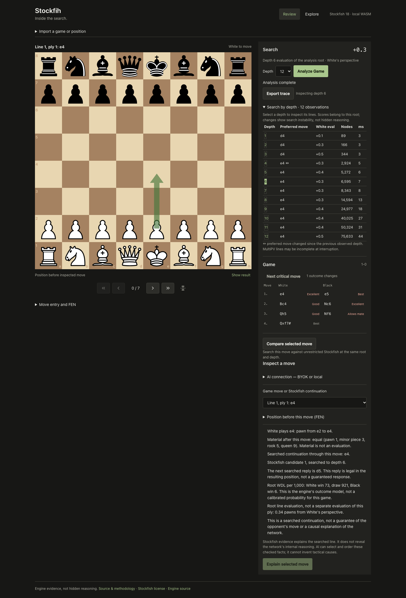
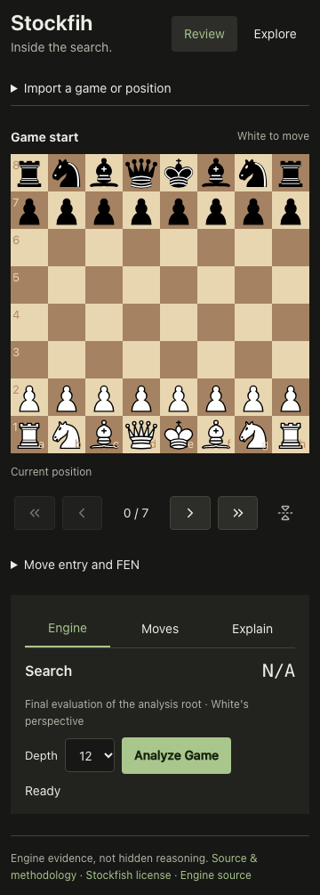

# A 60-second inspection

The sample opens without an account, key or model. [Watch the recording](demo/walkthrough.webm).

1. Choose **Analyze Game**. Stockfish runs in your browser; cancel/retry is available.
2. Open **Search by depth**, select a depth and see its legal candidate on the board.
   The table shows actual reported nodes, milliseconds, score and preferred-move changes.
3. Select **Compare selected move**. Inspect the alternative and searched reply
   from two fresh same-root searches, with a clear finite-depth caveat.
4. Choose a different candidate/PV ply. **Show result** applies that exact move;
   the displayed FEN and checked evidence retain its own position provenance.
5. Switch to **Explore**, play a legal move, then undo/redo. Return to Review:
   the imported main line is intact.
6. **Export trace** downloads the engine evidence/settings, with no AI keys.
   AI is optional: configure a local model or compatible BYOK endpoint and ask
   it to select checked facts. It cannot invent another move or tactical cause.

The recording is an automated real-Chromium walkthrough of the production
build with the actual shipped WASM. It contains no simulated engine/model
output. Re-record: `npm run build && STOCKFIH_DEMO=1 npm run test:browser`.

The engineering story is the working system: isolated asynchronous engine jobs,
legal chess/evidence boundaries, measured depth traces, constrained optional AI,
responsive independent UI and reproducible regression checks. Limits and audit
dispositions are explicit in AUDIT-STATUS.md. Search interpretation does not
claim causal access to Stockfish's network.
